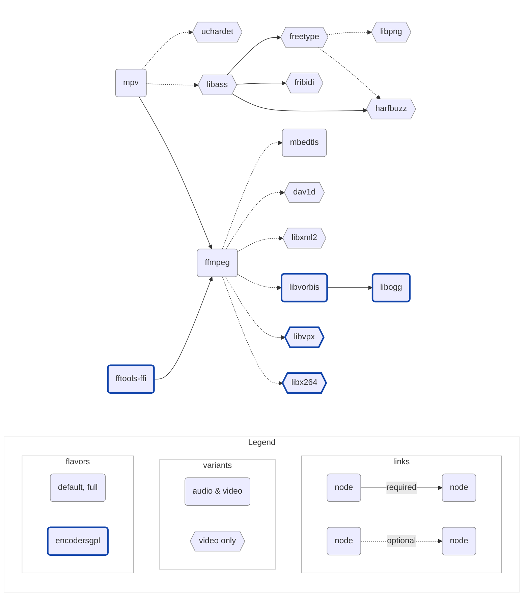

# libmpv build

Provides builds of [libmpv](https://github.com/mpv-player/mpv) for macOS & iOS,
used by [media_kit](https://github.com/alexmercerind/media_kit), compatible
with commercial use for playback, and GPL use for encoding.

Heavily inspired by [Homebrew](https://github.com/Homebrew/brew) and
[IINA](https://github.com/iina/iina).

## Setup

- Nix: [nixos.org/download/#nix-install-macos](https://nixos.org/download/#nix-install-macos)
- Xcode: [./nix/overlays/xcode.nix](./nix/overlays/xcode.nix)

> [!NOTE]
> If you plan to use Nix only temporarily, prefer the
> [Determinate Systems installer](https://github.com/DeterminateSystems/nix-installer)
> which ships a built-in uninstaller, unlike the official one.

## Build

```shell
$ nix develop -c make VERSION=v0.0.1
$ tree result
```

<details>
<summary>result</summary>

```shell
├── libmpv-libs_v0.0.1_ios-arm64-audio-default.tar.gz
├── libmpv-libs_v0.0.1_ios-arm64-audio-encodersgpl.tar.gz
├── libmpv-libs_v0.0.1_ios-arm64-audio-full.tar.gz
├── libmpv-libs_v0.0.1_ios-arm64-video-default.tar.gz
├── libmpv-libs_v0.0.1_ios-arm64-video-encodersgpl.tar.gz
├── libmpv-libs_v0.0.1_ios-arm64-video-full.tar.gz
├── libmpv-libs_v0.0.1_iossimulator-amd64-audio-default.tar.gz
├── libmpv-libs_v0.0.1_iossimulator-amd64-audio-encodersgpl.tar.gz
├── libmpv-libs_v0.0.1_iossimulator-amd64-audio-full.tar.gz
├── libmpv-libs_v0.0.1_iossimulator-amd64-video-default.tar.gz
├── libmpv-libs_v0.0.1_iossimulator-amd64-video-encodersgpl.tar.gz
├── libmpv-libs_v0.0.1_iossimulator-amd64-video-full.tar.gz
├── libmpv-libs_v0.0.1_iossimulator-arm64-audio-default.tar.gz
├── libmpv-libs_v0.0.1_iossimulator-arm64-audio-encodersgpl.tar.gz
├── libmpv-libs_v0.0.1_iossimulator-arm64-audio-full.tar.gz
├── libmpv-libs_v0.0.1_iossimulator-arm64-video-default.tar.gz
├── libmpv-libs_v0.0.1_iossimulator-arm64-video-encodersgpl.tar.gz
├── libmpv-libs_v0.0.1_iossimulator-arm64-video-full.tar.gz
├── libmpv-libs_v0.0.1_iossimulator-universal-audio-default.tar.gz
├── libmpv-libs_v0.0.1_iossimulator-universal-audio-encodersgpl.tar.gz
├── libmpv-libs_v0.0.1_iossimulator-universal-audio-full.tar.gz
├── libmpv-libs_v0.0.1_iossimulator-universal-video-default.tar.gz
├── libmpv-libs_v0.0.1_iossimulator-universal-video-encodersgpl.tar.gz
├── libmpv-libs_v0.0.1_iossimulator-universal-video-full.tar.gz
├── libmpv-libs_v0.0.1_macos-amd64-audio-default.tar.gz
├── libmpv-libs_v0.0.1_macos-amd64-audio-encodersgpl.tar.gz
├── libmpv-libs_v0.0.1_macos-amd64-audio-full.tar.gz
├── libmpv-libs_v0.0.1_macos-amd64-video-default.tar.gz
├── libmpv-libs_v0.0.1_macos-amd64-video-encodersgpl.tar.gz
├── libmpv-libs_v0.0.1_macos-amd64-video-full.tar.gz
├── libmpv-libs_v0.0.1_macos-arm64-audio-default.tar.gz
├── libmpv-libs_v0.0.1_macos-arm64-audio-encodersgpl.tar.gz
├── libmpv-libs_v0.0.1_macos-arm64-audio-full.tar.gz
├── libmpv-libs_v0.0.1_macos-arm64-video-default.tar.gz
├── libmpv-libs_v0.0.1_macos-arm64-video-encodersgpl.tar.gz
├── libmpv-libs_v0.0.1_macos-arm64-video-full.tar.gz
├── libmpv-libs_v0.0.1_macos-universal-audio-default.tar.gz
├── libmpv-libs_v0.0.1_macos-universal-audio-encodersgpl.tar.gz
├── libmpv-libs_v0.0.1_macos-universal-audio-full.tar.gz
├── libmpv-libs_v0.0.1_macos-universal-video-default.tar.gz
├── libmpv-libs_v0.0.1_macos-universal-video-encodersgpl.tar.gz
├── libmpv-libs_v0.0.1_macos-universal-video-full.tar.gz
├── libmpv-xcframeworks_v0.0.1_ios-universal-audio-default.tar.gz
├── libmpv-xcframeworks_v0.0.1_ios-universal-audio-default_Avcodec.zip
├── libmpv-xcframeworks_v0.0.1_ios-universal-audio-default_Avfilter.zip
├── libmpv-xcframeworks_v0.0.1_ios-universal-audio-default_Avformat.zip
├── libmpv-xcframeworks_v0.0.1_ios-universal-audio-default_Avutil.zip
├── libmpv-xcframeworks_v0.0.1_ios-universal-audio-default_Mbedcrypto.zip
├── libmpv-xcframeworks_v0.0.1_ios-universal-audio-default_Mbedtls.zip
├── libmpv-xcframeworks_v0.0.1_ios-universal-audio-default_Mbedx509.zip
├── libmpv-xcframeworks_v0.0.1_ios-universal-audio-default_Mpv.zip
├── libmpv-xcframeworks_v0.0.1_ios-universal-audio-default_Swresample.zip
├── libmpv-xcframeworks_v0.0.1_ios-universal-audio-default_Swscale.zip
├── libmpv-xcframeworks_v0.0.1_ios-universal-audio-encodersgpl.tar.gz
├── libmpv-xcframeworks_v0.0.1_ios-universal-audio-encodersgpl_Avcodec.zip
├── libmpv-xcframeworks_v0.0.1_ios-universal-audio-encodersgpl_Avfilter.zip
├── libmpv-xcframeworks_v0.0.1_ios-universal-audio-encodersgpl_Avformat.zip
├── libmpv-xcframeworks_v0.0.1_ios-universal-audio-encodersgpl_Avutil.zip
├── libmpv-xcframeworks_v0.0.1_ios-universal-audio-encodersgpl_Fftools-ffi.zip
├── libmpv-xcframeworks_v0.0.1_ios-universal-audio-encodersgpl_Mbedcrypto.zip
├── libmpv-xcframeworks_v0.0.1_ios-universal-audio-encodersgpl_Mbedtls.zip
├── libmpv-xcframeworks_v0.0.1_ios-universal-audio-encodersgpl_Mbedx509.zip
├── libmpv-xcframeworks_v0.0.1_ios-universal-audio-encodersgpl_Mpv.zip
├── libmpv-xcframeworks_v0.0.1_ios-universal-audio-encodersgpl_Ogg.zip
├── libmpv-xcframeworks_v0.0.1_ios-universal-audio-encodersgpl_Swresample.zip
├── libmpv-xcframeworks_v0.0.1_ios-universal-audio-encodersgpl_Swscale.zip
├── libmpv-xcframeworks_v0.0.1_ios-universal-audio-encodersgpl_Vorbis.zip
├── libmpv-xcframeworks_v0.0.1_ios-universal-audio-encodersgpl_Vorbisenc.zip
├── libmpv-xcframeworks_v0.0.1_ios-universal-audio-encodersgpl_Vorbisfile.zip
├── libmpv-xcframeworks_v0.0.1_ios-universal-audio-full.tar.gz
├── libmpv-xcframeworks_v0.0.1_ios-universal-audio-full_Avcodec.zip
├── libmpv-xcframeworks_v0.0.1_ios-universal-audio-full_Avfilter.zip
├── libmpv-xcframeworks_v0.0.1_ios-universal-audio-full_Avformat.zip
├── libmpv-xcframeworks_v0.0.1_ios-universal-audio-full_Avutil.zip
├── libmpv-xcframeworks_v0.0.1_ios-universal-audio-full_Mbedcrypto.zip
├── libmpv-xcframeworks_v0.0.1_ios-universal-audio-full_Mbedtls.zip
├── libmpv-xcframeworks_v0.0.1_ios-universal-audio-full_Mbedx509.zip
├── libmpv-xcframeworks_v0.0.1_ios-universal-audio-full_Mpv.zip
├── libmpv-xcframeworks_v0.0.1_ios-universal-audio-full_Swresample.zip
├── libmpv-xcframeworks_v0.0.1_ios-universal-audio-full_Swscale.zip
├── libmpv-xcframeworks_v0.0.1_ios-universal-video-default.tar.gz
├── libmpv-xcframeworks_v0.0.1_ios-universal-video-default_Ass.zip
├── libmpv-xcframeworks_v0.0.1_ios-universal-video-default_Avcodec.zip
├── libmpv-xcframeworks_v0.0.1_ios-universal-video-default_Avfilter.zip
├── libmpv-xcframeworks_v0.0.1_ios-universal-video-default_Avformat.zip
├── libmpv-xcframeworks_v0.0.1_ios-universal-video-default_Avutil.zip
├── libmpv-xcframeworks_v0.0.1_ios-universal-video-default_Dav1d.zip
├── libmpv-xcframeworks_v0.0.1_ios-universal-video-default_Freetype.zip
├── libmpv-xcframeworks_v0.0.1_ios-universal-video-default_Fribidi.zip
├── libmpv-xcframeworks_v0.0.1_ios-universal-video-default_Harfbuzz.zip
├── libmpv-xcframeworks_v0.0.1_ios-universal-video-default_Mbedcrypto.zip
├── libmpv-xcframeworks_v0.0.1_ios-universal-video-default_Mbedtls.zip
├── libmpv-xcframeworks_v0.0.1_ios-universal-video-default_Mbedx509.zip
├── libmpv-xcframeworks_v0.0.1_ios-universal-video-default_Mpv.zip
├── libmpv-xcframeworks_v0.0.1_ios-universal-video-default_Png16.zip
├── libmpv-xcframeworks_v0.0.1_ios-universal-video-default_Swresample.zip
├── libmpv-xcframeworks_v0.0.1_ios-universal-video-default_Swscale.zip
├── libmpv-xcframeworks_v0.0.1_ios-universal-video-default_Uchardet.zip
├── libmpv-xcframeworks_v0.0.1_ios-universal-video-default_Xml2.zip
├── libmpv-xcframeworks_v0.0.1_ios-universal-video-encodersgpl.tar.gz
├── libmpv-xcframeworks_v0.0.1_ios-universal-video-encodersgpl_Ass.zip
├── libmpv-xcframeworks_v0.0.1_ios-universal-video-encodersgpl_Avcodec.zip
├── libmpv-xcframeworks_v0.0.1_ios-universal-video-encodersgpl_Avfilter.zip
├── libmpv-xcframeworks_v0.0.1_ios-universal-video-encodersgpl_Avformat.zip
├── libmpv-xcframeworks_v0.0.1_ios-universal-video-encodersgpl_Avutil.zip
├── libmpv-xcframeworks_v0.0.1_ios-universal-video-encodersgpl_Dav1d.zip
├── libmpv-xcframeworks_v0.0.1_ios-universal-video-encodersgpl_Fftools-ffi.zip
├── libmpv-xcframeworks_v0.0.1_ios-universal-video-encodersgpl_Freetype.zip
├── libmpv-xcframeworks_v0.0.1_ios-universal-video-encodersgpl_Fribidi.zip
├── libmpv-xcframeworks_v0.0.1_ios-universal-video-encodersgpl_Harfbuzz.zip
├── libmpv-xcframeworks_v0.0.1_ios-universal-video-encodersgpl_Mbedcrypto.zip
├── libmpv-xcframeworks_v0.0.1_ios-universal-video-encodersgpl_Mbedtls.zip
├── libmpv-xcframeworks_v0.0.1_ios-universal-video-encodersgpl_Mbedx509.zip
├── libmpv-xcframeworks_v0.0.1_ios-universal-video-encodersgpl_Mpv.zip
├── libmpv-xcframeworks_v0.0.1_ios-universal-video-encodersgpl_Ogg.zip
├── libmpv-xcframeworks_v0.0.1_ios-universal-video-encodersgpl_Png16.zip
├── libmpv-xcframeworks_v0.0.1_ios-universal-video-encodersgpl_Swresample.zip
├── libmpv-xcframeworks_v0.0.1_ios-universal-video-encodersgpl_Swscale.zip
├── libmpv-xcframeworks_v0.0.1_ios-universal-video-encodersgpl_Uchardet.zip
├── libmpv-xcframeworks_v0.0.1_ios-universal-video-encodersgpl_Vorbis.zip
├── libmpv-xcframeworks_v0.0.1_ios-universal-video-encodersgpl_Vorbisenc.zip
├── libmpv-xcframeworks_v0.0.1_ios-universal-video-encodersgpl_Vorbisfile.zip
├── libmpv-xcframeworks_v0.0.1_ios-universal-video-encodersgpl_Vpx.zip
├── libmpv-xcframeworks_v0.0.1_ios-universal-video-encodersgpl_X264.zip
├── libmpv-xcframeworks_v0.0.1_ios-universal-video-encodersgpl_Xml2.zip
├── libmpv-xcframeworks_v0.0.1_ios-universal-video-full.tar.gz
├── libmpv-xcframeworks_v0.0.1_ios-universal-video-full_Ass.zip
├── libmpv-xcframeworks_v0.0.1_ios-universal-video-full_Avcodec.zip
├── libmpv-xcframeworks_v0.0.1_ios-universal-video-full_Avfilter.zip
├── libmpv-xcframeworks_v0.0.1_ios-universal-video-full_Avformat.zip
├── libmpv-xcframeworks_v0.0.1_ios-universal-video-full_Avutil.zip
├── libmpv-xcframeworks_v0.0.1_ios-universal-video-full_Dav1d.zip
├── libmpv-xcframeworks_v0.0.1_ios-universal-video-full_Freetype.zip
├── libmpv-xcframeworks_v0.0.1_ios-universal-video-full_Fribidi.zip
├── libmpv-xcframeworks_v0.0.1_ios-universal-video-full_Harfbuzz.zip
├── libmpv-xcframeworks_v0.0.1_ios-universal-video-full_Mbedcrypto.zip
├── libmpv-xcframeworks_v0.0.1_ios-universal-video-full_Mbedtls.zip
├── libmpv-xcframeworks_v0.0.1_ios-universal-video-full_Mbedx509.zip
├── libmpv-xcframeworks_v0.0.1_ios-universal-video-full_Mpv.zip
├── libmpv-xcframeworks_v0.0.1_ios-universal-video-full_Png16.zip
├── libmpv-xcframeworks_v0.0.1_ios-universal-video-full_Swresample.zip
├── libmpv-xcframeworks_v0.0.1_ios-universal-video-full_Swscale.zip
├── libmpv-xcframeworks_v0.0.1_ios-universal-video-full_Uchardet.zip
├── libmpv-xcframeworks_v0.0.1_ios-universal-video-full_Xml2.zip
├── libmpv-xcframeworks_v0.0.1_macos-universal-audio-default.tar.gz
├── libmpv-xcframeworks_v0.0.1_macos-universal-audio-default_Avcodec.zip
├── libmpv-xcframeworks_v0.0.1_macos-universal-audio-default_Avfilter.zip
├── libmpv-xcframeworks_v0.0.1_macos-universal-audio-default_Avformat.zip
├── libmpv-xcframeworks_v0.0.1_macos-universal-audio-default_Avutil.zip
├── libmpv-xcframeworks_v0.0.1_macos-universal-audio-default_Mbedcrypto.zip
├── libmpv-xcframeworks_v0.0.1_macos-universal-audio-default_Mbedtls.zip
├── libmpv-xcframeworks_v0.0.1_macos-universal-audio-default_Mbedx509.zip
├── libmpv-xcframeworks_v0.0.1_macos-universal-audio-default_Mpv.zip
├── libmpv-xcframeworks_v0.0.1_macos-universal-audio-default_Swresample.zip
├── libmpv-xcframeworks_v0.0.1_macos-universal-audio-default_Swscale.zip
├── libmpv-xcframeworks_v0.0.1_macos-universal-audio-encodersgpl.tar.gz
├── libmpv-xcframeworks_v0.0.1_macos-universal-audio-encodersgpl_Avcodec.zip
├── libmpv-xcframeworks_v0.0.1_macos-universal-audio-encodersgpl_Avfilter.zip
├── libmpv-xcframeworks_v0.0.1_macos-universal-audio-encodersgpl_Avformat.zip
├── libmpv-xcframeworks_v0.0.1_macos-universal-audio-encodersgpl_Avutil.zip
├── libmpv-xcframeworks_v0.0.1_macos-universal-audio-encodersgpl_Fftools-ffi.zip
├── libmpv-xcframeworks_v0.0.1_macos-universal-audio-encodersgpl_Mbedcrypto.zip
├── libmpv-xcframeworks_v0.0.1_macos-universal-audio-encodersgpl_Mbedtls.zip
├── libmpv-xcframeworks_v0.0.1_macos-universal-audio-encodersgpl_Mbedx509.zip
├── libmpv-xcframeworks_v0.0.1_macos-universal-audio-encodersgpl_Mpv.zip
├── libmpv-xcframeworks_v0.0.1_macos-universal-audio-encodersgpl_Ogg.zip
├── libmpv-xcframeworks_v0.0.1_macos-universal-audio-encodersgpl_Swresample.zip
├── libmpv-xcframeworks_v0.0.1_macos-universal-audio-encodersgpl_Swscale.zip
├── libmpv-xcframeworks_v0.0.1_macos-universal-audio-encodersgpl_Vorbis.zip
├── libmpv-xcframeworks_v0.0.1_macos-universal-audio-encodersgpl_Vorbisenc.zip
├── libmpv-xcframeworks_v0.0.1_macos-universal-audio-encodersgpl_Vorbisfile.zip
├── libmpv-xcframeworks_v0.0.1_macos-universal-audio-full.tar.gz
├── libmpv-xcframeworks_v0.0.1_macos-universal-audio-full_Avcodec.zip
├── libmpv-xcframeworks_v0.0.1_macos-universal-audio-full_Avfilter.zip
├── libmpv-xcframeworks_v0.0.1_macos-universal-audio-full_Avformat.zip
├── libmpv-xcframeworks_v0.0.1_macos-universal-audio-full_Avutil.zip
├── libmpv-xcframeworks_v0.0.1_macos-universal-audio-full_Mbedcrypto.zip
├── libmpv-xcframeworks_v0.0.1_macos-universal-audio-full_Mbedtls.zip
├── libmpv-xcframeworks_v0.0.1_macos-universal-audio-full_Mbedx509.zip
├── libmpv-xcframeworks_v0.0.1_macos-universal-audio-full_Mpv.zip
├── libmpv-xcframeworks_v0.0.1_macos-universal-audio-full_Swresample.zip
├── libmpv-xcframeworks_v0.0.1_macos-universal-audio-full_Swscale.zip
├── libmpv-xcframeworks_v0.0.1_macos-universal-video-default.tar.gz
├── libmpv-xcframeworks_v0.0.1_macos-universal-video-default_Ass.zip
├── libmpv-xcframeworks_v0.0.1_macos-universal-video-default_Avcodec.zip
├── libmpv-xcframeworks_v0.0.1_macos-universal-video-default_Avfilter.zip
├── libmpv-xcframeworks_v0.0.1_macos-universal-video-default_Avformat.zip
├── libmpv-xcframeworks_v0.0.1_macos-universal-video-default_Avutil.zip
├── libmpv-xcframeworks_v0.0.1_macos-universal-video-default_Dav1d.zip
├── libmpv-xcframeworks_v0.0.1_macos-universal-video-default_Freetype.zip
├── libmpv-xcframeworks_v0.0.1_macos-universal-video-default_Fribidi.zip
├── libmpv-xcframeworks_v0.0.1_macos-universal-video-default_Harfbuzz.zip
├── libmpv-xcframeworks_v0.0.1_macos-universal-video-default_Mbedcrypto.zip
├── libmpv-xcframeworks_v0.0.1_macos-universal-video-default_Mbedtls.zip
├── libmpv-xcframeworks_v0.0.1_macos-universal-video-default_Mbedx509.zip
├── libmpv-xcframeworks_v0.0.1_macos-universal-video-default_Mpv.zip
├── libmpv-xcframeworks_v0.0.1_macos-universal-video-default_Png16.zip
├── libmpv-xcframeworks_v0.0.1_macos-universal-video-default_Swresample.zip
├── libmpv-xcframeworks_v0.0.1_macos-universal-video-default_Swscale.zip
├── libmpv-xcframeworks_v0.0.1_macos-universal-video-default_Uchardet.zip
├── libmpv-xcframeworks_v0.0.1_macos-universal-video-default_Xml2.zip
├── libmpv-xcframeworks_v0.0.1_macos-universal-video-encodersgpl.tar.gz
├── libmpv-xcframeworks_v0.0.1_macos-universal-video-encodersgpl_Ass.zip
├── libmpv-xcframeworks_v0.0.1_macos-universal-video-encodersgpl_Avcodec.zip
├── libmpv-xcframeworks_v0.0.1_macos-universal-video-encodersgpl_Avfilter.zip
├── libmpv-xcframeworks_v0.0.1_macos-universal-video-encodersgpl_Avformat.zip
├── libmpv-xcframeworks_v0.0.1_macos-universal-video-encodersgpl_Avutil.zip
├── libmpv-xcframeworks_v0.0.1_macos-universal-video-encodersgpl_Dav1d.zip
├── libmpv-xcframeworks_v0.0.1_macos-universal-video-encodersgpl_Fftools-ffi.zip
├── libmpv-xcframeworks_v0.0.1_macos-universal-video-encodersgpl_Freetype.zip
├── libmpv-xcframeworks_v0.0.1_macos-universal-video-encodersgpl_Fribidi.zip
├── libmpv-xcframeworks_v0.0.1_macos-universal-video-encodersgpl_Harfbuzz.zip
├── libmpv-xcframeworks_v0.0.1_macos-universal-video-encodersgpl_Mbedcrypto.zip
├── libmpv-xcframeworks_v0.0.1_macos-universal-video-encodersgpl_Mbedtls.zip
├── libmpv-xcframeworks_v0.0.1_macos-universal-video-encodersgpl_Mbedx509.zip
├── libmpv-xcframeworks_v0.0.1_macos-universal-video-encodersgpl_Mpv.zip
├── libmpv-xcframeworks_v0.0.1_macos-universal-video-encodersgpl_Ogg.zip
├── libmpv-xcframeworks_v0.0.1_macos-universal-video-encodersgpl_Png16.zip
├── libmpv-xcframeworks_v0.0.1_macos-universal-video-encodersgpl_Swresample.zip
├── libmpv-xcframeworks_v0.0.1_macos-universal-video-encodersgpl_Swscale.zip
├── libmpv-xcframeworks_v0.0.1_macos-universal-video-encodersgpl_Uchardet.zip
├── libmpv-xcframeworks_v0.0.1_macos-universal-video-encodersgpl_Vorbis.zip
├── libmpv-xcframeworks_v0.0.1_macos-universal-video-encodersgpl_Vorbisenc.zip
├── libmpv-xcframeworks_v0.0.1_macos-universal-video-encodersgpl_Vorbisfile.zip
├── libmpv-xcframeworks_v0.0.1_macos-universal-video-encodersgpl_Vpx.zip
├── libmpv-xcframeworks_v0.0.1_macos-universal-video-encodersgpl_X264.zip
├── libmpv-xcframeworks_v0.0.1_macos-universal-video-encodersgpl_Xml2.zip
├── libmpv-xcframeworks_v0.0.1_macos-universal-video-full.tar.gz
├── libmpv-xcframeworks_v0.0.1_macos-universal-video-full_Ass.zip
├── libmpv-xcframeworks_v0.0.1_macos-universal-video-full_Avcodec.zip
├── libmpv-xcframeworks_v0.0.1_macos-universal-video-full_Avfilter.zip
├── libmpv-xcframeworks_v0.0.1_macos-universal-video-full_Avformat.zip
├── libmpv-xcframeworks_v0.0.1_macos-universal-video-full_Avutil.zip
├── libmpv-xcframeworks_v0.0.1_macos-universal-video-full_Dav1d.zip
├── libmpv-xcframeworks_v0.0.1_macos-universal-video-full_Freetype.zip
├── libmpv-xcframeworks_v0.0.1_macos-universal-video-full_Fribidi.zip
├── libmpv-xcframeworks_v0.0.1_macos-universal-video-full_Harfbuzz.zip
├── libmpv-xcframeworks_v0.0.1_macos-universal-video-full_Mbedcrypto.zip
├── libmpv-xcframeworks_v0.0.1_macos-universal-video-full_Mbedtls.zip
├── libmpv-xcframeworks_v0.0.1_macos-universal-video-full_Mbedx509.zip
├── libmpv-xcframeworks_v0.0.1_macos-universal-video-full_Mpv.zip
├── libmpv-xcframeworks_v0.0.1_macos-universal-video-full_Png16.zip
├── libmpv-xcframeworks_v0.0.1_macos-universal-video-full_Swresample.zip
├── libmpv-xcframeworks_v0.0.1_macos-universal-video-full_Swscale.zip
├── libmpv-xcframeworks_v0.0.1_macos-universal-video-full_Uchardet.zip
└── libmpv-xcframeworks_v0.0.1_macos-universal-video-full_Xml2.zip
```

</details>

## Build a specific target

```shell
$ nix flake show
$ nix develop -c make TARGET=mk-out-archive-libs-macos-universal-video-default
$ tree result
```

## macOS video networking

macOS `video` builds statically link curl **8.23.0**, nghttp2 **1.70.0**, and
OpenSSL **3.5.9** into libmpv for HTTP/1.1 and HTTP/2. Versions and source hashes
are pinned in [packages.lock.nix](./packages.lock.nix). The transport targets
macOS **11.0** and uses Apple SecTrust for native certificate trust. FFmpeg stays
at **7.1.5**; macOS audio and iOS keep their existing network backend.

The curl backend is enabled by default for the fixed FFmpeg 7.1.5 build. Set the
libmpv option `curl-enabled=no` to return to FFmpeg networking. Compatibility
patches preserve explicit proxy/direct routing, `network-timeout`, optional
streamed reconnects, and the existing TLS verification policy. HLS connection
options are adjusted only while curl is enabled, so disabling it preserves the
FFmpeg fallback's connection settings. HTTP/2 use depends on the remote server.

Nested HTTP requests honor `reconnect`, `reconnect_streamed`,
`reconnect_on_network_error`, and `reconnect_delay_max` passed through
`demuxer-lavf-o`. When any of these keys are present, that request's FFmpeg
settings take precedence over curl's retry policy; `curl-max-retries` still
limits retries. A delay limit of `5` permits waits of `0`, `1`, and `3` seconds,
then stops before the next wait of `7` seconds. Receiving data resets this
consecutive-failure budget. Requests without these keys keep curl's own policy.

The macOS video FFmpeg build also backports the upstream `io_close2` cleanup fix
needed by curl-backed HLS streams. Use the complete framework set from the same
build: pairing the new `Mpv.framework` with an older `Avformat.framework` can
crash when closing a playlist.

Run the policy tests from this repository with Python **3.9+**, Git, a C compiler,
and CMake available. `--mpv-source` must point to the **unpatched** mpv source
selected by `mpvMacosNativeVideo` in the lock file; the tests apply the patches to
a temporary copy:

```shell
/usr/bin/python3 -B tests/test_macos_curl_policy.py --mpv-source /path/to/unpatched-mpv
/usr/bin/python3 -B tests/test_curl_network_policy.py --mpv-source /path/to/unpatched-mpv --curl-prefix /path/to/curl-install
/usr/bin/python3 -B tests/test_macos_curl_open.py --mpv-source /path/to/unpatched-mpv
```

The first test checks version boundaries, HLS fallback behavior, and TLS options.
The second exercises real local HTTP/proxy servers, timeouts, cancellation, and
retries. Omit `--curl-prefix` to test the host curl instead of the built static
transport; this does not validate the release library.
The third deterministically completes a short response before `curl_open`
returns, checking that the consumer still starts at the correct byte offset.

The request-level reconnect test additionally needs a host-compatible FFmpeg
installation containing headers and libavutil. It checks the actual parser and
retry functions with a simulated clock, including cancellation and fallback:

```shell
/usr/bin/python3 -B tests/test_macos_curl_reconnect.py --mpv-source /path/to/unpatched-mpv --ffmpeg-prefix /path/to/ffmpeg-install
```

Check real libmpv playback and teardown with Python **3.9+** and the matching
frameworks installed side by side. The script configures the framework search
path for each child process. The test runs 19 isolated cases covering HLS EOF,
open failure, cancellation, recovery after an interrupted segment, and AES-128
encrypted HLS with curl on, off, and at its default, plus local and HTTP MPEG-TS
playback. The encrypted cases use the `openssl` executable to encrypt the same
fixture, including its padding; no separate encrypted media is required. Generate
a small fixture with an available FFmpeg executable:

```shell
mkdir -p /tmp/mpv-curl-fixture
ffmpeg -f lavfi -i testsrc2=size=64x64:rate=25 -t 2 -an -c:v mpeg2video -g 25 -f hls -hls_time 1 -hls_segment_filename /tmp/mpv-curl-fixture/seg%d.ts /tmp/mpv-curl-fixture/index.m3u8
/usr/bin/python3 -B tests/test_macos_curl_playback.py --library /path/to/frameworks/Mpv.framework/Versions/A/Mpv --fixture /tmp/mpv-curl-fixture
```

Use a library matching the host architecture. Per-case logs and JSON results
are retained in the printed artifact directory, including native crashes.

The completed review, validation coverage, and release checks are recorded in
[the macOS curl build audit](./docs/macos-curl-build-audit.md).

The [CI workflow](./.github/workflows/ci.yaml) runs on pushed tags matching `v*`.
Pushing the `curl` branch alone does not start a release build.

macOS video follows the `zcopy` branch configured under `mpvMacosNativeVideo`
in `packages.lock.nix`. Before every release build, CI resolves that branch to
one commit, downloads its archive and updates the commit URL and SHA-256 used by
Nix. Shared mpv changes therefore need no manual source-lock update. The chosen
commit and checksum appear in the workflow summary. The existing curl patches
and release checks must still pass for the selected source.

Direct local Nix builds use the checked-in snapshot. To refresh it from the
same tracked branch before a local build, run:

```shell
/usr/bin/python3 .github/scripts/update-macos-mpv-source.py
```

The macOS release verifier requires both `demuxer-mkv-skip-tags` and
`demuxer-mkv-defer-cues` in each CPU slice. Their library defaults stay disabled;
the application decides when to enable these file-local startup policies.

## Naming convention

```
libmpv-<format>_<version>_<os>-<arch>-<variant>-<flavor>[_<framework>].<extension>
```

| Component     | Notes                                     | Value                      |
| ------------- | ----------------------------------------- | -------------------------- |
| **format**    | Output format of built files              | libs, xcframeworks         |
| **version**   | Semantic version                          | v0.0.1, …                  |
| **os**        | Operating system                          | ios, iossimulator, macos   |
| **arch**      | Architecture                              | arm64, amd64, universal    |
| **variant**   | Usage context                             | audio, video               |
| **flavor**    | Available decoders and encoders           | default, full, encodersgpl |
| **framework** | SwiftPM binary target artifact (optional) | Mpv, Avcodec, Avformat, …  |
| **extension** | Packaging format                          | tar.gz, zip                |

Inclusion:

- Variants: $audio \subset video$
- Flavors: $audio \subset full \subset encodersgpl$

## Minimum versions

<table>
  <thead>
    <tr>
      <th>Platform</th>
      <th>Arch</th>
      <th>Min Version</th>
      <th>Notes</th>
    </tr>
  </thead>
  <tbody>
    <tr>
      <td rowspan="2"><strong>macOS</strong></td>
      <td>amd64</td>
      <td rowspan="2"><code>10.9</code> (audio), <code>11.0</code> (video)</td>
      <td rowspan="2">Legacy audio recipe; native macOS video and curl target 11.0</td>
    </tr>
    <tr>
      <td>arm64</td>
    </tr>
    <tr>
      <td><strong>iOS</strong></td>
      <td>arm64</td>
      <td><code>9.0</code></td>
      <td>Required by <code>ffmpeg</code></td>
    </tr>
    <tr>
      <td rowspan="2"><strong>iOS Simulator</strong></td>
      <td>amd64</td>
      <td><code>9.0</code></td>
      <td>Required by <code>ffmpeg</code></td>
    </tr>
    <tr>
      <td>arm64</td>
      <td><code>12.0</code></td>
      <td>Required by <code>xcodebuild -create-xcframework</code></td>
    </tr>
  </tbody>
</table>

## Dependencies



- [**mpv**](https://github.com/mpv-player/mpv): A free (as in freedom) media
  player for the command line. It supports a wide variety of media file formats,
  audio and video codecs, and subtitle types

- [**ffmpeg**](https://ffmpeg.org): A cross-platform solution for converting,
  streaming, and recording audio and video, with support for a wide range of
  codecs and formats

- [**fftools-ffi**](https://github.com/moffatman/fftools-ffi): FFmpeg's
  command-line interface exposed as a shared library for FFI usage

- [**libass**](https://github.com/libass/libass): A library for rendering
  subtitles in videos, with support for advanced text formatting and positioning
  features (made optional with a patch)

- [**fribidi**](https://github.com/fribidi/fribidi): A library for handling
  bidirectional text (such as Arabic or Hebrew) in Unicode strings, with support
  for complex shaping and layout

- [**freetype**](https://sourceforge.net/projects/freetype/): A library for
  rendering high-quality text in graphics applications, with support for a wide
  range of font formats and glyph rendering techniques

- [**harfbuzz**](https://github.com/harfbuzz/harfbuzz): A library for shaping
  and laying out text in multiple languages and scripts, with support for
  advanced typography features such as ligatures and kerning

- [**libpng**](https://github.com/pnggroup/libpng): A library for reading and
  writing PNG (Portable Network Graphics) images, providing efficient image
  compression and lossless data handling

- [**dav1d**](https://code.videolan.org/videolan/dav1d): A library for
  cross-platform AV1 decoding

- [**libogg**](https://github.com/xiph/ogg): Reference implementation of the Ogg
  media container

- [**libvorbis**](https://github.com/xiph/vorbis): Reference implementation of
  the Ogg Vorbis audio format

- [**libvpx**](https://gitlab.freedesktop.org/gstreamer/meson-ports/libvpx):
  Reference implementation of the VP8 and VP9 video formats

- [**libx264**](https://www.videolan.org/developers/x264.html): Free software
  library for encoding video streams into the H.264/MPEG-4 AVC compression
  format

- [**mbedtls**](https://www.libressl.org/): An open source, portable, easy to
  use, readable and flexible TLS library

- [**libxml2**](http://xmlsoft.org/): A library for processing XML data, used by
  ffmpeg to support the Dash protocol

- [**uchardet**](https://www.freedesktop.org/wiki/Software/uchardet/): A C++
  port of the Universal Character Encoding Detector (used by Mozilla Firefox
  and Thunderbird) for detecting the encoding of input text

## Commercial use

### macOS video transport (all flavors)

| Dependency | Licence | Commercial use |
| ---------- | ------- | :------------: |
| curl       | [curl licence (MIT-style)](https://curl.se/docs/copyright.html) | ✅ |
| nghttp2    | [MIT](https://github.com/nghttp2/nghttp2/blob/v1.70.0/COPYING) | ✅ |
| OpenSSL    | [Apache 2.0](https://github.com/openssl/openssl/blob/openssl-3.5.9/LICENSE.txt) | ✅ |

These libraries are included statically in macOS video libmpv. Their licence
texts (`curl.txt`, `nghttp2.txt`, and `openssl.txt`) are included in the release
artifacts:

- Dylib archives: `share/licenses/curl-transport/`.
- Frameworks: `Mpv.framework/Versions/A/Resources/Licenses/curl-transport/`.
  XCFramework archives and the individual Mpv XCFramework zip retain this
  directory inside the macOS slice of `Mpv.xcframework`.

Retain these licence resources when redistributing libmpv artifacts. The macOS
video artifact check rejects any missing or empty transport licence.

### Default, Full flavors

| Dependency | Licence                                                | Commercial use |
| ---------- | ------------------------------------------------------ | :------------: |
| mpv        | LGPL-2.1 (`-Dgpl=false`)                               |       ✅       |
| ffmpeg     | LGPL-2.1 (`--enable-gpl` & `--enable-nonfree` omitted) |       ✅       |
| libass     | ISC                                                    |       ✅       |
| freetype   | FreeType                                               |       ✅       |
| harfbuzz   | MIT                                                    |       ✅       |
| fribidi    | LGPL-2.1                                               |       ✅       |
| libpng     | zlib/libpng                                            |       ✅       |
| mbedtls    | Apache 2.0                                             |       ✅       |
| uchardet   | MPL-1.1, GPL-2, LGPL-2.1                               |       ✅       |
| libxml2    | MIT                                                    |       ✅       |
| dav1d      | BSD-2-clause                                           |       ✅       |

### Encoders-GPL flavor

| Dependency  | Licence                              | Commercial use |
| ----------- | ------------------------------------ | :------------: |
| mpv         | LGPL-2.1 (`-Dgpl=false`)             |       ✅       |
| ffmpeg      | GPL-2.1 (`--enable-nonfree` omitted) |       ❌       |
| libass      | ISC                                  |       ✅       |
| freetype    | FreeType                             |       ✅       |
| harfbuzz    | MIT                                  |       ✅       |
| fribidi     | LGPL-2.1                             |       ✅       |
| libpng      | zlib/libpng                          |       ✅       |
| mbedtls     | Apache 2.0                           |       ✅       |
| uchardet    | MPL-1.1, GPL-2, LGPL-2.1             |       ✅       |
| libxml2     | MIT                                  |       ✅       |
| dav1d       | BSD-2-clause                         |       ✅       |
| fftools-ffi | LGPL-2.1                             |       ✅       |
| libx264     | GPL-2.0+                             |       ❌       |
| libvpx      | BSD-3-clause                         |       ✅       |
| libvorbis   | BSD-3-clause                         |       ✅       |
| libogg      | BSD-3-clause                         |       ✅       |

## Notes

- Some dependencies, which are not needed at the moment, may be added in the
  future:
  - [**libbluray**](https://code.videolan.org/videolan/libbluray): A library for
    reading and parsing Blu-ray discs, with support for advanced features such
    as BD-J menus and seamless branching

  - [**libarchive**](https://github.com/libarchive/libarchive): A library for
    reading various archive formats, including tar and zip, with support for
    compression and metadata, and a flexible API for reading and extracting
    archive contents

- We use `meson` as much as possible in order to simplify cross-compilation, at
  the cost of some heaviness regarding legacy packages

## How the libass optional patch was created

As the dependency of mpv on libass is deeply embedded in the code, the simplest
solution was to:

1. Remove the dynamic linking in `meson.build`.
2. Include the `ass/ass.h` and `ass/ass_types.h` headers directly in the code
3. Remove the call to `ass_library_version` in `player/command.c`
4. Remove the calls to `ass_library_init`, called by `mp_ass_init`, in
   `sub/osd_libass.c` and `sub/sd_ass.c`

## Resources

- https://github.com/stps/mpv-ios-scripts
- https://github.com/iina/homebrew-mpv-iina
- https://github.com/mpv-android/mpv-android
- https://github.com/jnozsc/mpv-nightly-build
- https://github.com/smplayer-dev/mpv
- https://github.com/smplayer-dev/smplayer
- https://github.com/ldwardx/mpv-build-mac-iOS
- https://github.com/birros/godot_tl/tree/ca2fc4151bd8141241151dd6e29768608600473a/toolchains
- https://github.com/Vargol/ffmpeg-apple-arm64-build
- https://github.com/arthenica/ffmpeg-kit
